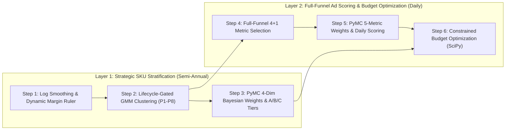

# SKU Stratification & Bayesian Ad Budget Optimization

**Bilingual (English / 简体中文) Interactive Decision Engine for E-Commerce Merchandising & Multi-Platform Ad Allocation**

> **Portfolio Highlight**: Replaces static experience-based ABC scoring and overlapping 7-metric ad rules with a **Two-Layer Six-Step** data-driven architecture combining **Strategic Role Clustering (GMM / K-Means)**, **Bayesian Hierarchical/Simplex Regression (PyMC)**, **Full-Funnel 4+1 Ad Metrics**, and **Constrained Nonlinear Optimization (SciPy)**.

---

## Live Interactive Demo & Deliverables

- **Interactive Web Application (`app.py` / `start_dashboard.bat`)**: Business-first **Streamlit + Plotly** dashboard with **one-click `English / 简体中文` language switching**, designed for non-technical stakeholders while keeping technical model diagnostics in optional collapsible panels:
  1. **Business Summary**: Plain-language 3-step overview, `$` budget shifts, and old-ABC vs. 8-role Sankey flow.
  2. **Product Roles (`P1–P8`)**: Intuitive `Sales Volume vs. Profit Margin` map, fair margin-cap comparison (`60%` vs `85%`), and SKU action lookup.
  3. **What Drives Each Role**: Visual comparison of initial team guesses vs. data-proven indicator weights per category.
  4. **Smart Budget Planner**: Live scenario presets (`Balanced` / `Growth` / `Profit Protection`), allocation spread selector, safety guardrails, and one-click `.xlsx` export.
  5. **Daily Action Alerts**: Plain-English ad issue diagnosis (`Creative Fatigue` / `Page Drop` / `Cost Spike`) with concrete fix suggestions.
- **Zero-Install HTML Executive Report**: Generated via `python -m scripts.export_html_report` (`outputs/interactive_report.html`) — open directly in any browser.
- **Architecture Specification**: See [项目架构.md](项目架构.md) for the complete Chinese system architecture design document.

---

## Architecture Overview: Two-Layer Six-Step Pipeline



### Key Business & Statistical Innovations

1. **8 Strategic Product Roles (`P1–P8`) Instead of One-Size-Fits-All ABC**  
   Evaluates each SKU relative to its lifecycle mission:
   - `P1` New Product Incubation · `P2` Hero Traffic Driver · `P3` Volume Scale Driver · `P4` Revenue Driver
   - `P5` High-Margin Harvester · `P6` Share Defender · `P7` Clearance Exit · `P8` Balanced Long-Tail
2. **Full-Funnel `4+1` Non-Overlapping Ad KPIs**  
   Eliminates collinearity among legacy metrics (`ROAS`, `ROI`, `CPM`, `CTR`, `CVR`, `CPC`, `CPA`) by pairing 4 orthogonal funnel stages (**F1 Reach → F2 Engagement CTR → F3 Conversion CVR → F4 Commercial Return ROAS/ACOS**) with **1 role-specific strategic indicator** (`New-to-Brand %`, `CAC`, `Sales Growth %`, `AOV`, `Margin Change %`, `Brand Search Growth %`, `Inventory Turnover Days`, `Repeat Rate`), with automatic reverse inversion for `ACOS`, `CAC`, and `Inventory Turnover Days`.
3. **Bayesian Weight Learning with Business Priors (`PyMC`)**  
   Encodes domain experience as Dirichlet simplex priors over feature importance, updates weights via NUTS MCMC sampling against role-aligned targets $Y$, and reports **95% Highest Density Intervals (HDI)** alongside **Spearman $\rho$** rank validation.
4. **Constrained Portfolio Optimization (`SciPy SLSQP` + KKT)**  
   Respects management's semi-annual category budget corridors (16 parameters across `P1–P8`), Layer-1 `A/B/C` tier multipliers (`100%–150%` / `70%–100%` / `30%–70%`), ACOS/ROAS guardrails, and diminishing-return concavity $\alpha$ to prevent single-SKU budget concentration.

---

## Project Structure

```text
├── app.py                        # Bilingual (EN / 中文) Streamlit + Plotly interactive app
├── requirements.txt              # Python dependencies
├── 项目架构.md                    # Complete refactored architecture specification (ZH)
├── data/
│   ├── demo/                     # Anonymized 2,511-SKU distribution + structured ad simulation
│   └── artifacts/                # Precomputed cluster, PyMC posterior, and optimization outputs
├── src/
│   ├── config.py                 # Canonical P1-P8 taxonomy, 4+1 metrics, priors, budget bounds
│   ├── i18n.py                   # Bilingual EN / 简体中文 UI dictionary
│   ├── data_generator.py         # Anonymizer & causally consistent multi-platform ad generator
│   ├── preprocessing.py          # Step 1: Log smoothing & configurable dynamic margin ruler
│   ├── clustering.py             # Step 2: Lifecycle-gated GMM clustering + Hungarian alignment + PCA
│   ├── bayesian_models.py        # Step 3 & 5: PyMC Dirichlet-prior Bayesian regression + 95% HDI
│   ├── scoring.py                # Step 5: Daily 0-100 scoring (reverse-inverted) & anomaly detector
│   ├── optimizer.py              # Step 6: SciPy constrained nonlinear budget optimizer & benchmark
│   ├── bootstrap.py              # Fast first-boot artifact generator for fresh clones / cloud deploy
│   └── run_pipeline.py           # End-to-end CLI pipeline runner
├── scripts/
│   ├── export_html_report.py     # Standalone Plotly HTML executive report builder
│   └── check_privacy.py          # Automated audit ensuring zero proprietary data leaks
└── tests/
    └── test_pipeline.py          # Pytest unit & constraint verification suite
```

---

## Quick Start

### 1. Local Setup & Run Interactive Dashboard

```bash
python -m venv .venv
# Windows PowerShell:
.\.venv\Scripts\Activate.ps1
# macOS / Linux:
# source .venv/bin/activate

pip install -r requirements.txt
streamlit run app.py
```

### 2. Re-run Full Modeling Pipeline (PyMC + Clustering + SciPy) & Tests

```bash
pytest -v
python -m src.run_pipeline
python -m scripts.export_html_report
python -m scripts.check_privacy
```

### 3. Deploy to Streamlit Community Cloud (Free Live URL)

1. Push this repository to GitHub.
2. Go to [share.streamlit.io](https://share.streamlit.io/), select this repository, set main file path to `app.py`, and click **Deploy**.
3. The precomputed files in `data/artifacts/` load immediately, while users can interactively adjust Margin Cap, category budget bounds, guardrails, and re-run `SciPy` optimization live in the browser.

---

## Empirical Benchmark Results (`seed=42`, `2,511` SKUs)

| Metric | Legacy Baseline (`arrangement_source.xlsx`) | Refactored Two-Layer Six-Step System | Uplift / Insight |
| :--- | :---: | :---: | :--- |
| **Product Stratification** | Unified ABC (`A: 500 / B: 1000 / C: 1011`) | 8 Strategic Roles (`P1–P8`, `150–532` SKUs each) | Role-aligned targets (`GMM + lifecycle guardrails`) |
| **Margin Normalization** | Fixed `Cap = 60%` (`56.4%` saturated at 100) | Configurable `Cap = 85%` (`3.0%` clipped) | Restores discrimination above 62.9% catalog median |
| **Bayesian Rank Validation** | Static manual weights (`21` ad params) | PyMC NUTS (`L1 Avg ρ = 0.784`, `L2 Avg ρ = 0.916`) | Posterior weights + 95% HDI intervals |
| **Simulated Portfolio ROAS** | `18.09x` (`$45,000` daily budget) | **`20.24x`** (`SciPy SLSQP + KKT`) | **`+11.85%` vs Legacy** (`+13.53%` vs unoptimized) |
| **Growth & Profit Focus (`P1+P2+P5`)** | `32.15%` of spend | **`50.71%`** of spend | `+18.56 pp` reallocation to high-priority roles |
| **Clearance Containment (`P7`)** | `4.12%` of spend | **`2.00%`** (controlled taper floor) | Curbs capital bleed into clearance SKUs |

---

## Data Governance & Confidentiality Note

To protect commercial confidentiality while preserving realistic e-commerce long-tail dynamics:
- All original SKU identifiers, supplier codes, brand names, and product descriptions have been anonymized (`SKU-0001`–`SKU-2511`, `SUP-xxx`, `Brand-xxx`).
- Unit financials carry light stochastic perturbation while retaining empirical skewness, return edges (`Sales < 0`), and margin structure (`56.1%` of catalog above `60%` margin).
- Multi-platform daily advertising time series (`Amazon Ads`, `TikTok Ads`, `Meta Ads`) are generated via causally consistent funnel equations (`Clicks = Impressions × CTR`, `Orders = Clicks × CVR`, `ROAS = Revenue / Spend`) seeded at `seed=42` for 100% reproducibility.
