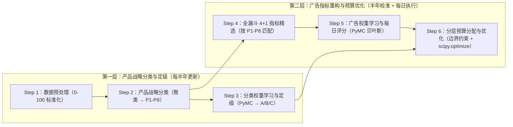

# 产品分层与广告预算优化：项目架构方案

> **副标题**：8 大产品战略类别 × 全漏斗 4+1 广告指标体系  
> **核心方法论**：产品角色聚类 × 贝叶斯回归（Bayesian Regression）× 分层约束预算优化  
> **版本**：V15.1（重构版）  
> **更新日期**：2026年11月（基于 2026年6月 V15.0 方案重构）

---

## 一、项目背景与核心问题诊断

### 1.1 项目全景

本项目包含两个紧密串联的阶段：
- **第一阶段（产品战略分类与定级）**：确定每个产品在业务版图中的战略角色与优先级；
- **第二阶段（广告指标评估与预算分配）**：决定每个产品在不同平台、不同广告类型上的推广资源如何配置。

当前两阶段均采用经验加权打分法，所有权重由业务人员手工设定。随着产品线规模扩大（当前 **2,511 SKU**）以及多平台广告投放复杂度上升，经验静态权重的局限性日益突出。

### 1.2 当前方案的核心缺陷

通过对现有两份基础数据表（`Classify_ABC_2024-03-14.xlsx` 与 `arrangement_source.xlsx`）以及 V13 方案的系统审计，识别出以下四个关键问题：

1. **缺陷一：缺少可量化的正确性标准**  
   无论是产品定级的 4 维度权重，还是广告分配的 `7 指标 × 3 等级 = 21 个独立权重`，均无法回答一个根本问题：*这组权重到底对不对？* 因为没有定义“正确”的客观目标函数。现有体系中两套产品定级方案（利润率加权 vs 利润额加权）平行运行，本身正体现了经验判断的不确定性。

2. **缺陷二：传统 ABC 分类的战略盲区**  
   传统 ABC 将所有产品放在同一把尺子上排名——“综合得分高就是好产品”。但实际业务中，产品承担着截然不同的战略角色：新品需要验证市场，引流款追求曝光与走量，利润款追求利润率与利润额，清仓款的核心目标是快速出清库存。用统一标准评分时，不同角色的产品会被系统性错估。

3. **缺陷三：广告指标之间存在因果重叠与角色混淆**  
   旧方案中的 7 个广告指标（`ROAS`、`ROI`、`CPM`、`CTR`、`CVR`、`CPC`、`CPA`）存在数学恒等关系与因果链重叠。例如 `CTR → CVR → ROAS` 是一条前后传导链，而 `CPC` 与 `CPA` 又可分别由 `CTR`、`CVR` 和出价/花费直接推导。将这 7 个指标混在一起加权，等同于对同一信号反复计分。此外，将结果指标（`ROAS`）、诊断指标（`CTR` / `CVR`）与成本指标（`CPC` / `CPA`）混入同一个加权池，混淆了不同层级指标的决策用途。

4. **缺陷四：权重无法随数据更新自动校准**  
   广告投放数据每日都在更新，但权重配置完全静态。即便业务人员凭直觉感知某个指标的重要性发生变化，也缺乏系统化方法去验证这一判断，更无法量化权重调整的合理幅度。

### 1.3 核心改进方向

本项目围绕**“产品分层 + 贝叶斯数据驱动 + 约束预算优化”**三大支柱重构决策体系，核心原则是——**不再拍脑袋定静态权重，而是用历史数据持续校准权重**：

- **产品角色聚类替代“一刀切”排名**：通过无监督聚类与业务标注将 SKU 划分为 8 大战略角色，让每个产品在自己的赛道内按对应的业务目标接受评估。
- **贝叶斯回归替代经验静态权重**：人的业务经验不会浪费——它被编码为贝叶斯回归的**先验分布（Prior）**；历史与新增数据流入后，模型自动计算**后验分布（Posterior）**与权重置信区间（95% HDI），形成“经验设定先验 → 数据修正为后验 → 周期迭代转为新先验”的持续学习闭环。
- **全漏斗 4+1 指标替代重叠指标池**：按全漏斗（Full Funnel）层级精选互不重叠的 4 个通用指标 + 1 个类别专属战略指标，并在战略预算边界内，结合产品定级系数与每日广告效果综合得分执行自动化预算分配。

---

## 二、整体架构：双层六步

整个项目分为两层架构、共六个核心步骤，覆盖从数据标准化、战略分类到指标评分与预算执行的完整链路：

| 层级 | 步骤 | 核心方法 | 输出 |
| :--- | :--- | :--- | :--- |
| 第一层 | **Step 1：数据预处理** | 对数平滑 + 动态标尺 | 4 维度标准化得分（0–100） |
| 第一层 | **Step 2：产品战略分类** | K-Means / GMM 聚类 + 人工标注 | 8 大产品战略类别标签（P1–P8） |
| 第一层 | **Step 3：分类权重学习与定级** | 贝叶斯回归（PyMC） | 各类别 4 维度权重（含 95% HDI）与类内 A/B/C 定级 |
| 第二层 | **Step 4：广告指标精选** | 全漏斗 4+1 指标框架 | 各类别专属的 5 个无重叠核心广告指标 |
| 第二层 | **Step 5：广告权重学习与每日评分** | 贝叶斯回归（PyMC） | 各类别 5 指标后验权重 + SKU 每日广告效果综合得分 |
| 第二层 | **Step 6：分层预算分配与优化** | 类别预算边界 + 约束优化（`scipy.optimize`） | 各类别预算配置及每产品每平台每日最优花费建议 |

**关键设计原则**：
- 上一步输出直接作为下一步输入，形成端到端可追溯的决策链路。
- **业务逻辑主导结构划分**：产品战略分类边界（Step 2）和全漏斗指标挑选（Step 4）由业务语义决定。
- **客观数据驱动参数求解**：产品维度权重（Step 3）、广告指标权重（Step 5）与每日预算分配（Step 6）由统计模型与优化求解器计算，且每一层均具备可量化的验证标准。

---

## 三、第一层：产品战略分类与定级（Step 1 – Step 3）

### 3.1 数据预处理（Step 1，继承 V13 改进）

首先将 SKU 的原始经营指标通过标准化方法映射为 `0–100` 的归一化得分，消除量纲差异与极端值干扰。

#### 对数平滑法 —— 适用于销量、销售额、利润额

对于绝对数值跨度极大（长尾分布明显）的规模类维度，采用对数变换压缩头部极值，防止少数爆款导致分值断层：

$$S_{\text{score}} = \frac{\ln(\text{实际值} + 1)}{\ln(\text{全店最大值} + 1)} \times 100$$

> **示例**：假设全店销量第一为 `100,000` 件，第二名为 `50,000` 件。经对数平滑后，第一名保持 `100` 分，第二名约为 `94` 分——既保留头部领先地位，又不至于让腰部产品得分被压缩到失去区分度。

#### 动态标尺法 —— 适用于利润率

利润率可能出现负值（清仓亏损品）或异常高值（成本异常或数据录入错误），需要引入上下限裁剪保护：

$$\text{Floor} = 0\%, \quad \text{Cap} = 60\%$$

$$S_{\text{margin}} = \frac{\min(\max(m,\, 0\%),\, 60\%) - 0\%}{60\% - 0\%} \times 100$$

超出 `[0%, 60%]` 范围的数值先裁剪至边界，再线性映射到 `0–100`：亏损品直接记 `0` 分，利润率超过 `60%` 的统一记 `100` 分，避免异常极值拉偏后续聚类与回归模型。

### 3.2 八类产品战略分类体系（Step 2）

传统 ABC 分类的问题在于用同一把尺子度量全部 SKU。实际运营中，不同生命周期和定位的产品承担着完全不同的任务。本方案结合**四个核心维度（销量、销售额、利润率、利润额）+ 首销日期与销售趋势**，先做自动聚类再经人工审核标注，建立覆盖产品全生命周期的 8 大战略类别：

| 编号 | 产品战略类别 | 核心特征 | 业务目标 | 典型产品画像 |
| :--- | :--- | :--- | :--- | :--- |
| **P1** | 新品孵化型 | 首销 `< 3 个月`，数据量小，波动大 | 快速验证市场响应，积累初始数据 | 刚上架的新 SKU，尚未形成稳定销售曲线 |
| **P2** | 爆款引流型 | 销量极高，利润率低（`< 10%`），低价走量 | 最大化曝光和流量获取，降低获客成本 | 对标竞品价格战的拳头产品，带动店铺整体流量 |
| **P3** | 销量驱动型 | 销量高，客单价中等，利润率适中 | 维持规模增长，扩大市场份额 | 主力走量款，虽非利润中心但是生意基本盘 |
| **P4** | 销售额驱动型 | 销售额高，客单价较高，表现稳定 | 贡献总营收，维持现金流健康 | 高客单价大件商品，单笔金额大但复购频次相对低 |
| **P5** | 高利润收割型 | 利润率极高（`> 40%`），销量中等或偏低 | 最大化单品/总利润，提升盈利质量 | 高附加值产品，销量不大但利润贡献突出 |
| **P6** | 份额防守型 | 销售额稳定，但销量环比持平或微降 | 保卫现有市场份额，防止被竞品蚕食 | 成熟期品类冠军，面临越来越多竞品围攻 |
| **P7** | 清仓退出型 | 销量下降，利润率很低或为负，库存积压 | 快速出清库存，回收现金流，腾出货架 | 过季款或将淘汰老品，库存周转天数异常高 |
| **P8** | 均衡长尾型 | 各维度均不突出但不亏损，数据稳定 | 维持运营效率，作为产品矩阵底座 | 大量不显眼但始终存在稳定需求的 SKU |

**分类体系的核心价值**：将评价准则从“所有产品拼一个综合总分”转变为“在所属战略角色内做好该做的事”。新品不需要和成熟爆款拼绝对销量，清仓款也不需要和高利润款比利润率。

### 3.3 分类权重学习：贝叶斯回归（Step 3a）

每个产品类别拥有独立的目标变量 $Y$。以四维度标准化得分（销量得分、销售额得分、利润率得分、利润额得分）作为自变量 $X$，各类别因变量 $Y$ 严格对齐其业务目标：

| 类别 | 因变量 $Y$（目标变量） | 设定依据 |
| :--- | :--- | :--- |
| **P1 新品孵化型** | 销量环比增长率 | 新品首要任务是验证市场接受度，看增速而非绝对体量 |
| **P2 爆款引流型** | 实际总销量（Sales） | 引流功能优先，规模是核心诉求 |
| **P3 销量驱动型** | 实际总销量（Sales） | 走量型产品以销量规模守住生意基本盘 |
| **P4 销售额驱动型** | 实际总销售额（Revenue） | 营收贡献型看总金额与现金流规模 |
| **P5 高利润收割型** | 利润额 × 利润率 | 兼顾利润绝对规模与盈利效率 |
| **P6 份额防守型** | 销售额稳定性（$1 - \text{方差}/\text{均值}$） | 防守期核心在于业绩稳定而非激进扩张 |
| **P7 清仓退出型** | 库存周转率 | 清仓的目标是加快出货速度，而非追求毛利 |
| **P8 均衡长尾型** | 实际总利润额（Profit） | 长尾底座追求整体综合运营收益 |

**为什么采用贝叶斯回归？**
1. **先验吸收业务经验**：将业务团队长期积累的经验权重转化为先验分布，不丢弃历史领域认知。
2. **持续迭代闭环**：每半年重新拟合时，上一周期的后验分布自然成为下一周期的先验分布，权重随业务变化平滑演进。
3. **量化不确定性**：输出每个维度权重的 **95% HDI（最高密度区间）**，能够清晰识别哪些权重结论稳健、哪些受限于样本量仍需观察。

### 3.4 分类内部定级（Step 3b）

在每个战略类别内部，使用贝叶斯回归学出的 4 维度后验权重计算 SKU 类内综合得分，并按得分排名划分三个子等级：

| 子等级 | 类内比例 | 业务含义 | 预算基数系数 |
| :--- | :--- | :--- | :--- |
| **A 级（核心）** | 前 20% | 该战略类别中表现最优的核心 SKU | 全力投入，预算基数 × `100%–150%` |
| **B 级（支撑）** | 20% – 60% | 表现稳健的中坚力量 | 常规投入，预算基数 × `70%–100%` |
| **C 级（观察）** | 后 40% | 表现偏弱或尚待观察验证 | 控制投入，预算基数 × `30%–70%` |

---

## 四、第二层：全漏斗广告指标体系重构（Step 4）

### 4.1 旧方案的核心问题

旧方案（`arrangement_source.xlsx`）将 7 个广告指标（`ROAS`、`ROI`、`CPM`、`CTR`、`CVR`、`CPC`、`CPA`）同时放入同一加权池，存在三大结构性缺陷：

1. **因果与数学重叠**：$\text{CPC} = \text{花费}/\text{点击}$、$\text{CVR} = \text{转化}/\text{点击}$、$\text{ROAS} = \text{收入}/\text{花费}$，三者存在强数学嵌套关系。高 CVR 产品往往同时伴随高 ROAS 与低 CPC，相当于同一驱动信号被重复计分三次。
2. **指标角色混淆**：`ROAS` 衡量最终商业回报，`CTR` 和 `CVR` 用于诊断漏斗转化瓶颈，`CPC` 和 `CPA` 反映单次互动/转化成本。把结果指标、诊断指标与成本指标混池加权，如同把方向盘、速度表和油量表都当作油门。
3. **参数过多导致区分度失效**：7 个指标叠加 3 个等级共需人工设定 21 个权重参数，指标过多导致单个指标权重被严重摊薄，最终排序区分度大幅下降。

### 4.2 指导原则：全漏斗 4+1 指标分工

重构后的广告指标框架遵循**全漏斗（Full Funnel）**原则，将通用评估拆解为四个互斥的漏斗层级，每层仅保留 1 个核心指标，彻底消除重复计分：

| 漏斗层级 | 核心指标（KPI） | 衡量内容 | 角色定位 |
| :--- | :--- | :--- | :--- |
| **F1：流量获取** | 点击量（Clicks） / 展示份额 | 广告带来了多少有效曝光或点击流量 | 规模指标 —— 衡量“获客触达能力” |
| **F2：互动质量** | 点击率（CTR） | 曝光中有多少受众被吸引并点击 | 效率指标 —— 衡量“素材与选品吸引力” |
| **F3：转化效能** | 转化率（CVR） | 点击后有多少用户完成购买 | 效果指标 —— 衡量“商品页说服力” |
| **F4：商业回报** | ROAS / ACOS | 广告投入与销售收入的回报比 | 结果指标 —— 衡量“最终投入产出效率” |

上述 4 个指标构成完整的因果链路：**展示 → 点击（CTR）→ 转化（CVR）→ 收入回报（ROAS / ACOS）**。

**为什么额外引入第 5 个“战略匹配指标”？**  
全漏斗指标衡量广告本身是否“跑得顺”，但无法反映投放是否契合产品当前的**战略使命**。因此，在 4 个通用漏斗指标之外，为每个类别配置 1 个专属战略指标——例如新品关注新客触达（`New-to-Brand %`）、清仓款关注出清速度（`库存周转天数`）、份额防守款关注品牌搜索防御（`品牌搜索量增长 %`）。

### 4.3 八类产品 × 五指标匹配方案

为 8 大战略类别精选的 `4 个通用漏斗指标 + 1 个类别专属战略指标` 如下：

| 类别 | 指标 1（F1 流量） | 指标 2（F2 互动） | 指标 3（F3 转化） | 指标 4（F4 回报） | 指标 5（类别战略指标） |
| :--- | :--- | :--- | :--- | :--- | :--- |
| **P1 新品孵化型** | 展示量 | CTR | CVR | ACOS | New-to-Brand % |
| **P2 爆款引流型** | 点击量 | CTR | CVR | ROAS | 获客成本 CAC |
| **P3 销量驱动型** | 点击量 | CTR | CVR | ROAS | 销量环比增长率 |
| **P4 销售额驱动型** | 展示份额 | CTR | CVR | ROAS | 平均客单价 |
| **P5 高利润收割型** | 点击量 | CTR | CVR | ROAS | 利润率变化 % |
| **P6 份额防守型** | 展示份额 | CTR | CVR | ROAS | 品牌搜索量增长 % |
| **P7 清仓退出型** | 展示量 | CTR | CVR | ACOS | 库存周转天数 |
| **P8 均衡长尾型** | 点击量 | CTR | CVR | ROAS | 复购率 / 稳定性 |

**关键选型逻辑解析**：

- **为什么 P1（新品）用 ACOS 而不是 ROAS？**  
  新品处于数据积累与市场验证期，目标是在控制试错成本上限的前提下获取曝光与转化，而非短期高盈利。`ACOS`（广告费占销售额比例，即 `1 / ROAS`）天然适合作为成本上限约束（“广告费率不超过 X%”）。配合 `New-to-Brand %`（新客占比），可检验新品是否真正触达增量用户而非仅收割老客。
- **为什么 P7（清仓）用库存周转天数 + ACOS？**  
  清仓款的核心目标不是赚高毛利，而是尽快回笼现金、释放库容。`库存周转天数`直接监控去化速度——若广告持续消耗但周转天数降不下来，说明投放策略失效；相应地，清仓允许放宽 `ACOS` 容忍度，以换取库存快速出清。
- **为什么 P6（份额防守）用展示份额 + 品牌搜索量增长？**  
  成熟期品类冠军的销售额往往接近天花板，单看 `ROAS` 容易误判为“缩减投放”，进而导致竞争对手抢占核心流量入口。防守期投放的真实目的是维持品牌心智占有率与类目卡位，`展示份额`与`品牌搜索量增长 %`直接衡量品类防线是否稳固。

### 4.4 指标含义速查表

| 指标 | 计算方式 | 衡量含义 | 方向性判断（是否越高越好） |
| :--- | :--- | :--- | :--- |
| **展示量（Impressions）** | 广告被展示的总次数 | 曝光绝对规模 | 不一定 —— 需结合 CTR 判断曝光质量 |
| **展示份额（Impression Share）** | 自身展示量 / 品类总展示量 | 品类中的曝光竞争地位 | **是** —— 反映流量卡位与防御力度 |
| **点击量（Clicks）** | 广告被点击的总次数 | 引入站内的流量规模 | 不一定 —— 需结合 CVR 判断有效流量 |
| **CTR（点击率）** | 点击量 / 展示量 | 素材吸引力与受众匹配度 | **是** —— 越高说明广告越吸引点击 |
| **CVR（转化率）** | 转化订单数 / 点击量 | 详情页与商品自身说服力 | **是** —— 越高说明承接转化越顺畅 |
| **ROAS** | 广告归因收入 / 广告花费 | 每 1 元广告费换回的收入 | **是** —— 但不同战略类别合理阈值不同 |
| **ACOS** | 广告花费 / 广告归因收入 | 广告费占销售额比例 | **否（越低越省）** —— 新品/清仓可适当放宽 |
| **CAC（获客成本）** | 广告总花费 / 新获取客户数 | 获取单个新客户的成本 | **否（越低越高效）** |
| **New-to-Brand %** | 新客购买数 / 总购买数 | 触达增量新客的效率 | 新品越高越好；成熟老品可适当放低 |
| **品牌搜索量增长 %** | $(\text{本月} - \text{上月}) / \text{上月}$ | 品牌心智占有率变化趋势 | **是** —— 反映品牌主动搜索防御力 |
| **库存周转天数** | 平均库存 / 日均销量 | 库存消化出清的速度 | **否（越低出清越快）** |
| **复购率** | 重复购买客户数 / 总客户数 | 客户粘性与长期复购质量 | **是** —— 长尾款保持稳定即可 |

---

## 五、类别内广告指标权重学习与每日评分（Step 5）

每个产品战略类别内的 5 个广告指标权重，同样不再人工拍脑袋设定，而是通过贝叶斯回归从历史投放数据中自动学习。

### 5.1 各分类的回归目标变量

| 类别 | 自变量 $X$（5 个精选指标） | 因变量 $Y$（回归目标） | 权重学习目的 |
| :--- | :--- | :--- | :--- |
| **P1 新品孵化型** | 展示量、CTR、CVR、ACOS、NTB% | 第 $T+30$ 天销量 | 识别哪些前期指标组合最能预测 30 天后的市场起量 |
| **P2 爆款引流型** | 点击量、CTR、CVR、ROAS、CAC | 总流量（点击量 + 展示量） | 识别哪些指标组合最有效驱动店铺流量扩张 |
| **P3 销量驱动型** | 点击量、CTR、CVR、ROAS、销量增速 | 总销量 | 识别哪些指标最能解释并拉动销量规模增长 |
| **P4 销售额驱动型** | 展示份额、CTR、CVR、ROAS、客单价 | 总销售额 | 识别哪些指标组合与总营收贡献最相关 |
| **P5 高利润收割型** | 点击量、CTR、CVR、ROAS、利润率变化 | 总利润额 | 识别真正驱动净利润（而非虚胖营收）的广告信号 |
| **P6 份额防守型** | 展示份额、CTR、CVR、ROAS、品牌搜索量 | 销售额稳定性指数 | 识别哪些指标最能守住既有份额、防止下滑 |
| **P7 清仓退出型** | 展示量、CTR、CVR、ACOS、库存周转天数 | 库存下降速度 | 识别哪些投放特征去库存最快 |
| **P8 均衡长尾型** | 点击量、CTR、CVR、ROAS、复购率 | 总利润额 | 评估长尾组合的综合持续盈利能力 |

### 5.2 学习后的每日评分流程

每半年使用贝叶斯回归重新拟合一次各分类的 5 指标后验权重（取后验均值作为运行权重 $w_1 \sim w_5$，并同步检查 95% HDI 稳健性）。每日自动化管线运行时，基于最新清洗后的广告表现数据计算每个 SKU 的**每日广告效果综合得分**：

$$\text{每日得分} = w_1 \cdot Z(\text{流量指标}_1) + w_2 \cdot Z(\text{CTR}) + w_3 \cdot Z(\text{CVR}) + w_4 \cdot Z(\text{回报指标}_4) + w_5 \cdot Z(\text{战略指标}_5)$$

- 其中 $Z(\cdot)$ 表示在同战略类别内标准化到 `0–100` 的指标得分；
- 对于“越低越好”的逆向指标（如 `ACOS`、`CAC`、`库存周转天数`），在标准化阶段执行**反向映射**（即数值越低、标准化得分越高），确保 5 项得分均满足“越高代表表现越优”；
- **该得分不孤立决定绝对花费**，而是作为第六步预算分配引擎的核心输入信号之一，与第一层产品定级结果、类别预算边界及平台约束联合求解。

### 5.3 “产品定级 × 贝叶斯广告评分”双信号协同机制

1. **产品战略定级（每半年更新）决定“基础预算权限”**：通过 Step 3 输出的 A/B/C 子等级及基数系数（`100%–150%` / `70%–100%` / `30%–70%`），锚定 SKU 在所属类别中的长期战略优先级与资源底座。
2. **每日广告综合得分（每日更新）决定“动态调节方向”**：通过类别专属 5 指标权重反映 SKU 当前的投放效率与战略目标达成度——同一战略档位内，综合得分领先且满足 ROI/ACOS 安全线的产品自动获得更高预算倾斜；得分持续走低的产品自动缩减投放并触发异常诊断。
3. **跨周期持续自我修正**：随着每日投放与转化数据不断沉淀，每半年一次的贝叶斯重拟合会自动根据新数据修正 $w_1 \sim w_5$，实现“数据驱动校准”替代“静态经验拍板”。

---

## 六、跨类预算分配与动态调整机制（Step 6）

### 6.1 两层预算分配架构

预算分配采用**“战略边界 + 战术优化”**两层架构：管理层只需管好大类盘子的风险边界，日常 SKU 与平台级的精细化分配完全交给模型自动完成。

#### 第一层：战略层（管理层每半年审批）

管理层只需决策 8 个产品类别的**最低保障预算比例**与**最高上限比例**（共计约 16 个战略控制参数），其余细节无需人工干预。参考配置示例如下：

| 类别 | 预算策略定位 | 最低保障 | 最高上限 | 战略说明 |
| :--- | :--- | :--- | :--- | :--- |
| **P1 新品孵化型** | 保护性预算 | 总预算 × `5%` | 总预算 × `15%` | 给新品留出充足试错空间，但防止无底洞烧钱 |
| **P2 爆款引流型** | 扩张性预算 | 总预算 × `15%` | 总预算 × `30%` | 流量款是店铺发动机，保障充足弹药 |
| **P3 销量驱动型** | 稳定性预算 | 总预算 × `10%` | 总预算 × `20%` | 守住销量基本盘，保持稳健不过度激进 |
| **P4 销售额驱动型** | 回报性预算 | 总预算 × `10%` | 总预算 × `20%` | 现金流主力产品，向高回报渠道倾斜 |
| **P5 高利润收割型** | 效率性预算 | 总预算 × `10%` | 总预算 × `25%` | 盈利质量最高的类别，但需防范细分市场规模天花板 |
| **P6 份额防守型** | 防御性预算 | 总预算 × `5%` | 总预算 × `15%` | 核心在于守住阵地，防止竞品抢占搜索位 |
| **P7 清仓退出型** | 收缩性预算 | 总预算 × `2%` | 总预算 × `8%` | 目标是快速出清库存，不恋战、不超投 |
| **P8 均衡长尾型** | 基础性预算 | 总预算 × `5%` | 总预算 × `10%` | 维持长尾矩阵日常曝光，不刻意强拉 |

#### 第二层：战术层（模型每日自动优化）

在战略层确定的各类别预算上下限 $[B_{c,\min},\, B_{c,\max}]$ 内部，**预算优化引擎**每日自动运行，综合以下输入求解各 SKU 在各平台上的最优日预算：

- **输入信号**：
  1. 第一层产品定级结果（SKU 的 P1–P8 类别归属、A/B/C 子等级与基数系数）；
  2. 第二层广告效果综合得分（Step 5 计算的每日 5 指标加权得分）；
  3. 业务与平台护栏约束（单品最低起投门槛、单平台预算上限、日预算波动幅度限制、ROAS 下限 / ACOS 上限）。
- **求解方式**：  
  使用约束非线性优化器（`scipy.optimize` 的 `SLSQP` 或 `trust-constr`），以**产品定级权重 × 广告效果综合得分**作为综合效用权重，并引入**凹效用函数（如对数平滑或边际效用递减惩罚）**，在满足类别总额及单品护栏约束下求得全局最优分配方案——既能将预算向高分核心品倾斜，又避免极少数头部 SKU 吸干全类预算导致流量结构失衡。

### 6.2 类别间产品流转机制

产品在业务生命周期中的角色并非一成不变。每半年周期重新运行数据预处理与聚类后，部分 SKU 会发生跨类流转：

> **典型流转路径**：新品孵化（P1）→ 爆款引流（P2）/ 销量驱动（P3）/ 销售额驱动（P4）→ 高利润收割（P5）/ 均衡长尾（P8）→ 份额防守（P6）→ 清仓退出（P7）

流转发生后，该 SKU 将自动切换至新类别对应的 **4 维度评价权重、5 指标广告体系、回归目标及预算边界**，无需人工逐一改写规则。

---

## 七、全流程执行节奏

| 执行频率 | 核心任务 | 执行主体 | 输入数据 | 输出结果 |
| :--- | :--- | :--- | :--- | :--- |
| **每半年** | 数据预处理：对数平滑 + 动态标尺 | 自动化脚本 | ERP / 销售系统原始数据 | 4 维度 `0–100` 标准化得分 |
| **每半年** | 产品聚类重跑，确认 P1–P8 归属与流转 | 算法 + 人工审核 | 标准化得分 + 首销/趋势特征 | 每个 SKU 的战略类别标签 |
| **每半年** | 产品维度贝叶斯回归重拟合 | 自动化脚本 | 历史销量/营收/利润 + 分类标签 | 8 组 4 维度权重（含 95% HDI）+ A/B/C 定级 |
| **每半年** | 广告指标贝叶斯回归重拟合 | 自动化脚本 | 历史广告表现数据 + 分类标签 | 8 组 5 指标广告权重（含 95% HDI） |
| **每半年** | 跨类预算战略边界审批 | 管理层 + 算法 | 各类别历史表现 + 公司战略目标 | 8 组类别预算上下限参数 |
| **每日** | 广告数据 ETL：从各投放平台 API 拉取 | 自动化管线 | Amazon Ads / TikTok Ads 等 | 清洗对齐后的日级广告表现数据 |
| **每日** | 广告效果评分：按分类 5 指标权重打分 | 自动化脚本 | 日级广告数据 + 8 组 5 指标权重 | 每个 SKU 的每日广告效果综合得分 |
| **每日** | 预算优化分配：求解类别内最优配置 | 自动化脚本 | 类别预算边界 + 定级系数 + 每日得分 + 约束 | 每产品每平台每日最优预算建议 |
| **每日** | 异常监控：ROAS / CTR / CVR 突变告警 | 自动化 + 人工 | 实际投放表现与模型预期偏差 | 异常告警清单 + 漏斗诊断报告 |

---

## 八、技术栈建议

| 系统层级 | 推荐技术选型 | 核心用途说明 |
| :--- | :--- | :--- |
| **数据预处理** | Python（`pandas`, `numpy`） | 对数变换、动态标尺裁剪、缺失值与异常值处理 |
| **产品聚类** | Python（`scikit-learn`） | K-Means / GMM 聚类，轮廓系数辅助确定聚类边界 |
| **贝叶斯回归（产品 & 广告）** | Python（`PyMC`） | 先验设定、MCMC 采样（NUTS）、后验分布与 95% HDI 分析 |
| **每日广告评分引擎** | Python（`pandas`, `numpy`） | 按类别标准化（含逆向指标翻转）并加权计算每日综合得分 |
| **预算约束优化** | Python（`scipy.optimize`） | 基于产品定级、每日得分与多级约束执行非线性优化（`SLSQP` / `trust-constr`） |
| **每日 ETL 调度** | Apache Airflow 或 `cron` | 广告平台 API 抓取 → 数据仓库清洗 → 驱动模型评分与优化 |
| **报表与决策输出** | Python（`openpyxl`）→ Excel | 自动生成分类清单、每日预算分配建议表与异常诊断报告 |

---

## 九、方案迭代记录

| 版本 | 日期 | 主要变更 |
| :--- | :--- | :--- |
| **V13** | 2024-03 | 引入对数平滑法和动态标尺法；确定 `40/40/20` 经验权重；ABC 分类按总分排名取前 `5%` 为 A、`5%–30%` 为 B、后 `70%` 为 C。 |
| **V14** | 2026-06 | 新增产品角色聚类替代统一 ABC 排名；引入贝叶斯回归自动学习权重；建立 Spearman 验证标准；新增利润额为第四维度；优化分层预算分配架构。 |
| **V15** | 2026-06 | 重构产品分类体系为 8 大战略类别（P1–P8）；重构广告指标框架为全漏斗 `4+1` 模型（4 个通用漏斗指标 + 1 个类别专属战略指标）；消除 7 指标因果重叠问题；建立清晰的指标分工（流量/互动/转化/回报/战略）；新增产品类别间流转机制；引入非亚马逊平台指标（New-to-Brand、品牌搜索量等）。 |
| **V15.1** | 2026-11 | 架构精简与重构，完全收敛为“产品战略聚类 × 双层贝叶斯回归（产品定级 + 5 指标权重学习）× 约束预算优化”闭环；理顺 Step 5 与 Step 6 的衔接关系及逆向指标标准化规则。 |

---

## 十、下一步行动建议

1. **近期（1–2 周）：数据摸底与聚类验证**  
   使用 `Classify_ABC_2024-03-14.xlsx` 的现有数据，按本方案的四维度预处理与分类标准对 `2,511` 个 SKU 做一次聚类实验，检验自然聚类数量、各群样本量均衡度及聚类参数合理性，验证 P1–P8 分类边界在历史数据中的可分性。

2. **中期（1–2 月）：第一层原型开发**  
   完成“数据预处理 + 产品聚类 + 贝叶斯回归”第一层完整原型。核心交付：8 个战略类别的 SKU 清单、每个类别贝叶斯学习到的 4 维度权重（含 95% HDI）、类内 A/B/C 定级结果，以及与传统 ABC 分类结果的对比诊断。

3. **中长期（2–4 月）：第二层原型与预算优化上线**  
   接入每日广告平台数据，为 8 个类别分别训练 5 指标贝叶斯权重模型并上线每日广告效果综合评分引擎；结合第一层产品定级系数与管理层设定的类别预算边界，搭建基于 `scipy.optimize` 的预算优化原型。核心交付：每类内部 SKU 广告表现排名、每日每产品每平台预算分配建议，以及优化前后核心效率指标（ROAS / ACOS 及各类别战略指标）的对比验证。
